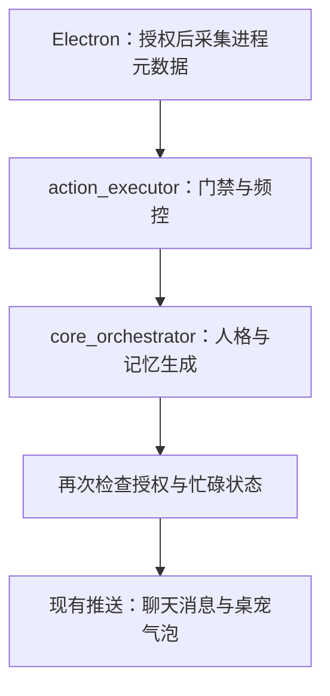

# dsh-pet 借鉴、兼容与验证

本次以 `TrisomyManager/AgentGirl` 的 `7951dcc06252f94d7753169a0ee29dc7721d7c4a` 为集成基线，对照 [MerZlin/dsh-pet-indesktop](https://github.com/MerZlin/dsh-pet-indesktop/tree/34d810b1eadd98d00e7cb9b3b51428a45b5bf03e)（v4.4.0）。实现针对仓库代码；不包含未推送的个人电脑改动。

结论：保留小暖的编排、人格、分层记忆和设备架构；借鉴 dsh-pet 的主动介入门禁、稳定偏好层、轻量离线检索和启动期功能快照。桌宠通过 Electron 展示适配器兼容源素材包，避免再启动一套 Qt 对话、记忆和工具系统。

## 对比与取舍

| 维度 | dsh-pet 的长处与限制 | 小暖原有长处与短板 | 本次落地 |
|---|---|---|---|
| 主动陪伴 | 白名单、停留/闲置判断、频控、忙碌保护、识屏路径与请求限流/熔断较细；依赖本机桌面状态 | 有定时问候、未互动关怀、记忆回访、SSE/轮询和每日限额；缺少桌面情境与用户级开关，回访会被通用闲聊优先级遮挡 | 用户授权、进程白名单、服务端停留计时、锁屏/全屏/通话/拖动保护；复用冷却和每日限额；回访优先；失败不计数、生成后再次检查状态 |
| 对话记忆 | `user/fact/lesson/topic` 分层、稳定用户层常驻、BM25 风格召回、去重与短预算，离线轻便；语义泛化和结构关系能力较弱 | 六类长期记忆、向量、图谱事实、工作记忆、关系指标和跨端持久化更完整；无 embedding 时 SHA 开发向量不代表语义，稳定偏好易依赖查询命中 | 保留原有类别/向量/图谱；无 embedding 时用中文二元词组与英文词的词法排序；剔除过期项；稳定偏好独立注入；限制召回片段预算 |
| 功能管理 | 功能登记、依赖解析、本次运行冻结/下次启动生效、迁移和入口/执行多层门控；坏配置保守开启全部模块 | 后端模块有环境开关，核心/端间边界明确；缺少用户可见的统一启用清单与待生效状态 | 四个可选功能登记、依赖校验、原子保存、active/pending 状态和设置页；坏配置保留并报错；核心服务始终保留 |
| 桌宠 | Qt 桌面交互成熟，视频/帧序列、游走、多宠、事件动作完整；不是 Live2D，整体移植会带来另一套 UI/业务运行时 | 已有 Electron/Vue、托盘、设备桥与 Live2D；缺少透明桌面角色窗口 | 新增独立透明置顶窗口、拖动、点击动作、穿透与托盘找回、源 WebM/GIF 素材扫描、主动消息气泡 |

参考源码：[主动频控](https://github.com/MerZlin/dsh-pet-indesktop/blob/34d810b1eadd98d00e7cb9b3b51428a45b5bf03e/pet/proactive_limiter.py)、[记忆召回](https://github.com/MerZlin/dsh-pet-indesktop/blob/34d810b1eadd98d00e7cb9b3b51428a45b5bf03e/pet/chat/memory_recall.py)、[功能快照](https://github.com/MerZlin/dsh-pet-indesktop/blob/34d810b1eadd98d00e7cb9b3b51428a45b5bf03e/pet/feature_activation.py)。本次按小暖架构独立实现，未引入外部源码树、Qt/OCR/识屏模型或上游角色素材。

## 运行边界



桌宠不访问记忆、模型、工具或任意文件路径。专用 preload 只暴露展示、拖动和菜单接口；选定的媒体通过随机令牌协议读取，跳过符号链接，不接收素材包中的人格提示词。

桌面采集默认关闭。采样周期 8 秒，只上传进程名、闲置秒数、锁屏/全屏/忙碌/交互布尔值；不读窗口标题，不截图、不 OCR、不读文件内容。45 秒未更新的元数据失效。任一新鲜设备处于忙碌状态时抑制打扰；同一设备同一次应用停留只主动问候一次。后端按自己的单调时钟累计停留，不信任客户端传来的停留时长。

原有免打扰时段、冷却和每日总上限继续生效；当前时区使用服务端本地时区，每日计数使用 UTC，沿用原有行为。桌面触发、回访和问候共用额度。模型返回后复查授权/状态，通过后发布推送，再提交对话记忆；被丢弃的生成不污染对话记忆。推送发布不等于客户端已读，沿用现有消息总线的交付语义。前端按用户及消息 ID 对 SSE、轮询和刷新重放去重。

## 本地启动与启用

后端 Python 3.11+；验证环境 Python 3.12。先建立虚拟环境，再安装：

```bash
cd apps/backend
uv venv .venv
uv pip install --python .venv/bin/python -e '.[dev,arch]' aiosqlite
COMPANION_LITE_MODE=true .venv/bin/python -m uvicorn main:app --host 127.0.0.1 --port 8000
```

Windows 使用 `.venv\Scripts\python.exe` 和 PowerShell 的 `$env:COMPANION_LITE_MODE="true"`。实际生成对话仍需配置原有 LLM；无密钥可验证健康、设置、门禁与记忆测试。

PC 客户端（Windows，已验证构建的 Node 版本为 22.23/24.19）：

```powershell
cd apps/pc-client
npm ci
$env:VITE_API_BASE_URL="http://127.0.0.1:8000"
$env:XIAONUAN_API_BASE_URL="http://127.0.0.1:8000"
npm run dev
```

`VITE_API_BASE_URL` 用于渲染器、`XIAONUAN_API_BASE_URL` 用于既有设备客户端；非默认端口应同时设置。Windows 进程元数据采集还需要 PATH 中可运行 `python`（标准库，无新增 Python 包）。缺少 Python 或不支持的操作系统返回不可用，桌宠显示与聊天仍可独立使用。

1. 打开“设置 → 陪伴与功能”，在全局功能中勾选“主动关怀”和“桌面情境陪伴”，保存并重启后端。
2. 开启当前用户的“根据桌面情境关心我”，白名单逐行填写 `Code.exe` 等进程名，保存。
3. 导入有权使用的 dsh-pet 单个角色目录或其 `videos` 目录，开启“显示桌宠”。素材仅保留在本机选定目录，移动/删除后需重新导入。
4. 穿透后从托盘“显示桌宠并恢复鼠标交互”找回。关闭用户陪伴偏好即时生效；全局模块选择下次启动生效。

功能文件默认 `apps/backend/companion_features.json`，可用 `COMPANION_FEATURE_CONFIG_PATH` 指定持久数据目录。首次无配置时继承 `enable_voice`、`enable_action_2d`、`proactive_enabled` 的现值，桌面情境默认关闭。`proactive_enabled=false` 仍是主动关怀的环境总闸；启用功能清单不能越过它。已保存清单决定下一次启动的可选模块，空列表是有效选择。配置损坏时保留原文件并阻止错误启动，应修复该文件后再启动，不会静默开启全部功能。

## 新增协议

| 接口 | 请求/响应要点 |
|---|---|
| `GET /settings/features` | `active_enabled`、`pending_enabled`、`restart_required`、带依赖的 `features` |
| `PUT /settings/features` | `{ "enabled": ["proactive_care", "desktop_context"] }`；整值保存，422 依赖/ID 错误，503 写盘失败；下次启动生效 |
| `GET /actions/proactive/preferences?user_id=…` | 当前 `policy` 与 `desktop_context_active` |
| `PUT /actions/proactive/preferences?user_id=…` | 完整 policy：`enabled`、`desktop_enabled`、`allowed_apps`、`dwell_seconds`、`min_idle_seconds`；SQLite/Postgres 持久化 |
| `POST /actions/proactive/context` | `user_id`、`device_id`、`foreground_app`、`idle_seconds` 和四个状态布尔值；返回 `accepted/eligible/reason`；未启用/未授权 409，额外字段 422 |

可选功能 ID 为 `voice_layer`、`action_layer`、`proactive_care`、`desktop_context`。最后一项依赖主动关怀。全局设置影响整个服务；本次沿用已有本地 API 的身份与访问模型，不新增多租户管理员授权。需要暴露给外网时，必须先由现有网关统一保护这些设置端点。

## 记忆策略与局限

- 稳定用户层只从既有 `user_profile` 读取称呼及 `latest_like/preferred_tone/interests/dislikes`，最多 600 字符，不序列化任意配置/密钥。它不新建一套事实库，也不把主观推断自动变成永久事实。
- 记忆片段最多 3 条、单条最多 600 字符、总计 1200 字符；图谱事实总计 600 字符并去重。这是新增片段的字符预算，工作记忆/近期对话仍沿用原流程，不宣称整个提示词总 token 数已经封顶。
- 有可用 embedding 时保留原语义检索；无配置/服务回退时改用实际文本的词法排序，不再将 SHA 随机向量视为语义。无相关词命中就返回空，不用重要度强行召回无关记忆。
- 词法检索是降级路径，对同义改写和单个汉字查询能力有限；当前按用户加载候选集，数据量大时仍需 FTS/独立索引。未验证生产 PostgreSQL/pgvector 实例。
- 情境状态为单进程内存，重启重新累计停留；部署暂按单 worker。多 worker 需共享状态与分布式调度锁，不能仅把 worker 数调大。
- 本次未移植 dsh-pet 的截图/OCR、变化检测、请求熔断与 dry-run，也没有其全套新装/升级槽位迁移；采用我们现有服务端调度和持久日志。后续若加入视觉模型，应单独设计授权、请求预算与熔断。

## 兼容范围与素材许可

兼容 WebM/GIF 源动作目录（`idle/idle_turn/turn/move/click/drag/random/events`）；上游实际角色包扫描验证 106 段。当前播放待机、点击与拖动动作，收到主动消息显示气泡。`body_box` 可解析并验证，但当前固定窗口仍按整幅 640×360 素材缩放，不提供逐像素命中测试。GIF 单次动作的结束控制不等同视频 `ended`；可在下一次交互切换。

暂不支持纯 WebP 预转换帧缓存包、Qt 的自由游走/碰撞/多宠共存、口型同步或完整随机事件调度。Linux 无显示环境仅完成解析和构建，Windows 透明视频、鼠标拖动、DPI/多屏/打包安装仍需真机验收。

上游代码 [MIT](https://github.com/MerZlin/dsh-pet-indesktop/blob/34d810b1eadd98d00e7cb9b3b51428a45b5bf03e/LICENSE)，角色素材的授权单独约束（上游说明为非商业使用）。本提交没有复制或分发上游角色素材；不得把代码 MIT 许可当作角色商用授权。

## 验证结果

- Lite Mode 后端：`pytest -q --ignore=voice_layer/tests/test_voice.py --ignore=memory_system/tests/test_memory.py`：353 passed。保留既有 warning，未将依赖真实语音/数据库的文件算作通过。
- 新增测试覆盖授权/白名单/停留/忙碌/过期状态、用户与设备隔离、生成失败、生成期间撤销与全屏变化、推送后记忆提交、功能依赖/原子写失败、离线中文召回/过期记忆/语义路径、预算与稳定偏好。
- Web 与 PC 的 `npm run build` 通过（包括类型检查）；PC `npm run test:pet` 覆盖中文文件名、符号链接隔离、空包和非法可选 manifest。
- 真实 Uvicorn HTTP 验证：health/features 200；授权前/关闭后 409；授权后 `dwelling`；忙碌为 `busy`；截图字段 422。测试服务器已停止。
- 新增前端去重回归断言通过；当前 Vitest 在报告断言后无法退出，Node 22/24 及既有语音测试均复现，故不记作整个前端测试套件通过。
- 新增 Python 文件 ruff 通过，`git diff --check` 通过。全库 ruff 和架构检查存在基线问题；对照未修改基线，反向依赖 2→2、跨业务模块位置 17→17、直接模型 SDK 0→0、人格硬编码 79→79，无新增架构违规位置。未放宽规则或重写基线。
